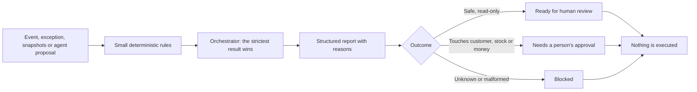

# Project Velvet


**AI-ready operational workflows for professional beauty commerce.**

Project Velvet explores how backend workflows can make order operations more reliable, explainable, and safe to automate. It uses synthetic data and generic business scenarios.

The core idea: **deterministic code enforces policy; AI may summarize evidence or suggest next steps, but never bypasses transition rules, risk thresholds, or human approval.**

The project is backend-only: no UI, real customer data, live integrations, or automatic business actions.

## What is included

| Area | Demos |
|---|---|
| Decide | Order lifecycle consistency, exception triage, order reconciliation |
| Control | AI workflow governance, strict agent-proposal contract, audit trail and human review |
| Verify | Agent evaluation and regression, skill-contract testing, decision replay |
| Release | Policy-change impact analysis, release-readiness gate |
| Coordinate | Operational workflow orchestration over a shared synthetic dataset |

Each demo returns a structured decision with explicit reasons, fails closed on invalid or unknown input, and never executes an action. Details for every demo and policy are in the [demo and policy reference](docs/DEMO_REFERENCE.md).

## How it fits together



## Quick start

Requires Python 3.11+.

```bash
python -m pip install -e ".[dev]"
pytest
python examples/run_shared_dataset.py
python examples/show_shipment_review.py
```

All 18 runnable examples are listed in the [demo reference](docs/DEMO_REFERENCE.md), and every one of them is executed by the test suite, so the documented commands cannot silently break.

## Flagship scenario: colour-restock incident

One fictional salon restock order loses a line when a shade runs short. The [flagship walkthrough](docs/FLAGSHIP_SCENARIO.md) traces it through lifecycle, triage, and reconciliation, then runs four different agent proposals (read-only, customer notice, stock correction, automatic shade substitution) through the same incident. Only the proposal changes; the outcomes range from human review to blocked, and nothing is ever executed.

```bash
python examples/show_colour_restock_incident.py
```

One of the four outcomes, exactly as the script prints it. The proposal is unsupported, so the workflow is blocked and nothing is executed:

```json
{
  "workflow_id": "wf-8204",
  "proposed_action": { "id": "act-7204", "type": "AUTO_SUBSTITUTE_SHADE" },
  "governance": { "outcome": "MANUAL_REVIEW", "allowed_to_execute": false, "approval_required": true },
  "workflow_status": "BLOCKED",
  "reasons": [
    "High-severity reconciliation discrepancy requires human review.",
    "Exception priority or risk requires human review.",
    "Governance could not safely classify the proposed action."
  ],
  "action_executed": false
}
```

| Proposal on the same incident | Governance | Workflow status |
|---|---|---|
| Read-only inspection | `ALLOW` | `HUMAN_REVIEW_REQUIRED` |
| Draft a customer notice | `REQUIRE_APPROVAL` | `HUMAN_REVIEW_REQUIRED` |
| Propose a stock correction | `REQUIRE_APPROVAL` | `HUMAN_REVIEW_REQUIRED` |
| Automatic shade substitution | `MANUAL_REVIEW` | `BLOCKED` |

## Worked example: shipment delay requiring human review

The shared scenario `shipment-delay-customer-review` shows how separate checks combine without giving an agent permission to act:

1. **Triage:** fictional order `ord-4105` has a shipment-delay exception aged 30 hours with customer impact, so it is prioritized for operational attention.
2. **Reconciliation:** the two synthetic snapshots disagree on status (`CONFIRMED` versus `SHIPPED`). The workflow reports the mismatch; it does not guess which system is correct.
3. **Governance:** the proposed customer update is classified as customer communication, which requires human approval. No message is sent.
4. **Orchestration:** the combined report carries the evidence and review requirement forward instead of treating one successful sub-check as permission to execute.

Run `python examples/show_shipment_review.py` to see the structured outcome. The scenario is illustrative and synthetic; it demonstrates coordination and decision boundaries, not a live commerce integration.

## Testing and quality gates

CI runs on Python 3.11, 3.12 and 3.13: Ruff lint checks, Pyright static type checks, and the test suite with `pytest-cov`, requiring at least **95% statement coverage** for the `velvet` package (currently 100%). The suite includes tests that run every example script and feed bad input to every validator. Coverage and static analysis catch different classes of problems; neither proves that scenarios are complete, policy is correct, or production behavior is safe.

## Scope boundaries

These demos are in-memory evaluators. They do **not** persist an event ledger, mutate a real order, or trigger payment, cancellation, shipment, refund, stock adjustment, or customer communication. Duplicate detection is only against IDs supplied in the current evaluation call; production-grade idempotency would need an atomic, durable event ledger. Version checking detects conflicts but does not resolve concurrency. Exception priorities and thresholds are illustrative policy choices, not claims about any real platform's operating rules.

## Documentation

Start with the [documentation index](docs/README.md). Highlights:

- [Logic guide](docs/LOGIC_GUIDE.md): how each workflow decides, what the statuses mean, where the safety boundaries sit.
- [Workflow walkthrough](docs/WORKFLOW_WALKTHROUGH.md) and [shipment review](docs/SHIPMENT_REVIEW_WALKTHROUGH.md): guided routes through the linked scenarios.
- [Architecture](docs/ARCHITECTURE.md): layers, module-to-test-to-example map, and design rules; plus the [Mermaid diagrams](docs/diagrams/).
- [Scenario catalog](datasets/SCENARIO_CATALOG.md): stable scenario IDs and what each demonstrates.
- [Extending the demos](docs/EXTENDING_THE_DEMOS.md): checklist for adding rules, scenarios, and tests consistently.
- [Roadmap](docs/ROADMAP.md): what would be improved next, in priority order, and why.

## License

Released under the [MIT License](LICENSE).

## Repository layout

```text
src/velvet/     workflow modules (policies and evaluators)
tests/          unit tests, one file per module
examples/       runnable scripts and their JSON fixtures
datasets/       shared synthetic operational demo pack and scenario catalog
contracts/      machine-readable governance contract
skills/         reusable agent skill instructions (SKILL.md per workflow)
docs/           guides, reference, and diagrams/ (Mermaid)
.github/        CI workflow
```
