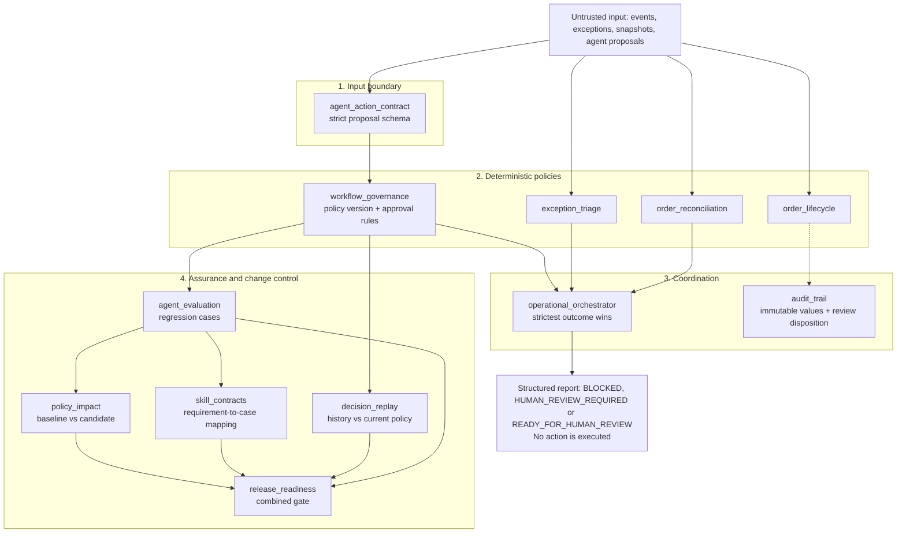

# Architecture

Project Velvet is a set of small, deterministic evaluators. Each takes plain data in, returns a structured decision with reasons, and never executes anything. This page shows how they connect and where to find the code, tests, and runnable example for each part.

The simpler boundary-level view is in [diagrams/architecture-overview.mmd](diagrams/architecture-overview.mmd).

## Layers

Solid arrows show data flow between components; the dotted arrow shows `audit_trail` building on lifecycle decisions. `operational_orchestrator`, `agent_action_contract`, `agent_evaluation`, `decision_replay`, and `release_readiness` import exactly the modules they point to or from; `skill_contracts` and `policy_impact` are linked by shared case and decision-record data rather than imports.

## Component map

| Layer | Module | Responsibility | Tests | Example | Diagram |
|---|---|---|---|---|---|
| Boundary | [agent_action_contract](../src/velvet/agent_action_contract.py) | Validate untrusted proposals (exactly four non-empty string fields) before policy is applied | [test_agent_action_contract](../tests/test_agent_action_contract.py) | [evaluate_agent_proposals](../examples/evaluate_agent_proposals.py) | |
| Policy | [order_lifecycle](../src/velvet/order_lifecycle.py) | Allowed transitions, duplicate IDs, version conflicts | [test_order_lifecycle](../tests/test_order_lifecycle.py) | [run_demo](../examples/run_demo.py) | [flow](diagrams/order-lifecycle-flow.mmd), [states](diagrams/order-lifecycle-states.mmd) |
| Policy | [exception_triage](../src/velvet/exception_triage.py) | Priority (P1-P3), team routing, human-review flag | [test_exception_triage](../tests/test_exception_triage.py), [test_boundary_values](../tests/test_boundary_values.py) | [triage_demo](../examples/triage_demo.py) | [flow](diagrams/order-exception-triage-flow.mmd) |
| Policy | [order_reconciliation](../src/velvet/order_reconciliation.py) | Field-level comparison of two snapshots, severity | [test_order_reconciliation](../tests/test_order_reconciliation.py), [test_boundary_values](../tests/test_boundary_values.py) | [reconciliation_demo](../examples/reconciliation_demo.py) | [flow](diagrams/order-reconciliation-flow.mmd) |
| Policy | [workflow_governance](../src/velvet/workflow_governance.py) | Allow, require approval, or manual review for a proposed action | [test_workflow_governance](../tests/test_workflow_governance.py), [test_governance_boundary_consistency](../tests/test_governance_boundary_consistency.py) | [governance_demo](../examples/governance_demo.py) | [flow](diagrams/ai-workflow-governance-flow.mmd) |
| Coordination | [operational_orchestrator](../src/velvet/operational_orchestrator.py) | Combine triage, reconciliation, and governance; strictest outcome wins | [test_operational_orchestrator](../tests/test_operational_orchestrator.py), [test_orchestrator_scenario_matrix](../tests/test_orchestrator_scenario_matrix.py) | [run_operational_workflow](../examples/run_operational_workflow.py), [show_shipment_review](../examples/show_shipment_review.py) | [flow](diagrams/operational-workflow-orchestration-flow.mmd) |
| Coordination | [audit_trail](../src/velvet/audit_trail.py) | Immutable audit values and human-review dispositions | [test_audit_trail](../tests/test_audit_trail.py) | [audit_demo](../examples/audit_demo.py) | [flow](diagrams/audit-trail-review-flow.mmd) |
| Assurance | [agent_evaluation](../src/velvet/agent_evaluation.py) | Run versioned cases against the governance evaluator | [test_agent_evaluation](../tests/test_agent_evaluation.py) | [evaluate_agent_policy](../examples/evaluate_agent_policy.py) | [flow](diagrams/agent-evaluation-regression-flow.mmd) |
| Assurance | [skill_contracts](../src/velvet/skill_contracts.py) | Check that every requirement maps to existing case IDs | [test_skill_contracts](../tests/test_skill_contracts.py) | [check_skill_contracts](../examples/check_skill_contracts.py) | [flow](diagrams/skill-contract-testing-flow.mmd) |
| Assurance | [decision_replay](../src/velvet/decision_replay.py) | Compare stored decisions with current policy output | [test_decision_replay](../tests/test_decision_replay.py) | [replay_decisions](../examples/replay_decisions.py) | [flow](diagrams/decision-replay-observability-flow.mmd) |
| Assurance | [policy_impact](../src/velvet/policy_impact.py) | Flag relaxed approvals and removed cases between policy versions | [test_policy_impact](../tests/test_policy_impact.py) | [analyze_policy_impact](../examples/analyze_policy_impact.py), [evaluate_policy_regression](../examples/evaluate_policy_regression.py) | [flow](diagrams/policy-change-impact-analysis-flow.mmd) |
| Assurance | [release_readiness](../src/velvet/release_readiness.py) | Combine regression, contracts, replay, and impact into one gate | [test_release_readiness](../tests/test_release_readiness.py) | [release_readiness_report](../examples/release_readiness_report.py) | [flow](diagrams/release-readiness-gating-flow.mmd) |
| Data | [demo_dataset](../src/velvet/demo_dataset.py), [shared_scenarios](../src/velvet/shared_scenarios.py) | Validate and evaluate the shared synthetic pack | [test_demo_dataset](../tests/test_demo_dataset.py) | [run_shared_dataset](../examples/run_shared_dataset.py), [validate_demo_dataset](../examples/validate_demo_dataset.py) | |

## Design rules the structure enforces

1. **Deterministic code is the authority.** Policies are plain functions of their input; AI output, if any, is only data that goes through the input boundary first.
2. **Fail closed.** Malformed, missing, or unknown input produces `BLOCKED` or `MANUAL_REVIEW`, never an implicit allow.
3. **Strictest outcome wins.** The orchestrator never lets a passing check lower a status set by another check. This is verified by the [scenario matrix](../tests/test_orchestrator_scenario_matrix.py), which covers all 54 combinations of triage, action, and reconciliation outcomes.
4. **Allowed is not executed.** A decision permits or gates an action; nothing here performs it. `READY_FOR_HUMAN_REVIEW` is deliberately not "approved".
5. **Changes to policy are themselves tested.** Regression cases, replay, impact analysis, and the release gate exist so that relaxing a rule is visible before it ships.

## What is not here

No persistence, identity or approval capture, execution layer, or live model calls. See the scope boundaries in the [README](../README.md#scope-boundaries).
